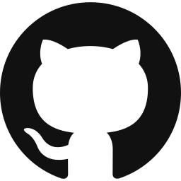

<div align="center">


# Week 1: Lab Setup, Linux and Networking Foundations

**DG Interns Hub | Cybersecurity Internship**

 &nbsp;
 &nbsp;
 &nbsp;
 &nbsp;
 &nbsp;



</div>

---

| | |
|---|---|
| **Intern** | Harini E |
| **Intern ID** | DG/15/OCT/CYBER/040 |
| **Position** | Cyber Security Intern |
| **Week** | 1 |
| **Topic** | Lab setup, Linux and networking foundations |
| **Lab** | VirtualBox: Kali Linux, Ubuntu Server, Windows host |

## About this week

Hello, I'm Harini. This folder holds my Week 1 work for the DG Interns Hub internship. Week 1 was about building the ground I will stand on for the rest of the internship. I built a small virtual lab, practised Linux and networking commands until they felt natural, mapped my own network, and wrote notes, writeups and a cheat sheet along the way.

## Contents

1. [Task status](#task-status)
2. [The lab](#the-lab)
3. [What I did](#what-i-did)
4. [Writeups and notes](#writeups-and-notes)
5. [Folder structure](#folder-structure)
6. [Privacy](#privacy)
7. [What I learned](#what-i-learned)
8. [LinkedIn posts](#linkedin-posts)

## Task status

| Task | Status | Where to find it |
|---|---|---|
| Lab setup | Done | [Findings/Lab Setup](Findings/Lab%20Setup) |
| Linux practice | Done | [Findings/Linux Practice](Findings/Linux%20Practice) |
| Network map | Done | [Findings/Network Map](Findings/Network%20Map) |
| Linux cheat sheet | Done | [Cheat Sheet/linux-cheat-sheet.md](Cheat%20Sheet/linux-cheat-sheet.md) |
| Theory notes | Done | [Notes](Notes) |
| TryHackMe writeups | Done | [Writeups/tryhackme](Writeups/tryhackme) |
| Bandit writeups, levels 0 to 10 | Done | [Writeups/Bandit](Writeups/Bandit) |
| Bandit screenshots | Done | [Findings/Over the Wire Bandit](Findings/Over%20the%20Wire%20Bandit) |
| Weekly LinkedIn post | Done | [LinkedIn posts](#linkedin-posts) |
| PDF report | Done | In this Week 1 folder |
| Presentation | Done | In this Week 1 folder |

## The lab

 I used VirtualBox with two command-line virtual machines, connected through a Host-only network, `192.168.56.0/24`. Each VM also has a NAT adapter for internet access, and I connected to the Ubuntu VM over SSH from Windows. Because of limited storage, the Windows host was used as the third node.

| Machine | Role in the lab |
|---|---|
| Kali Linux (Kali-CLI) | Command-line VM for testing and practice |
| Ubuntu Server (Ubuntu-lab) | Command-line VM that I reach over SSH from Windows |
| Windows host | Third node of the lab, because of limited storage |

| Network adapter | Purpose |
|---|---|
| Host-only (192.168.56.0/24) | Lets the machines talk to each other |
| NAT | Gives each VM internet access |

## What I did

### Lab setup

 

I created the two VMs, set up the Host-only network, added a NAT adapter to each VM, and confirmed with pings that the machines could reach each other. I also took two snapshots, so I can return to a clean state if something breaks.

Evidence: [`Findings/Lab Setup`](Findings/Lab%20Setup)

### Linux practice


I ran 30 Linux commands and saved each command with its output, as a log and as a markdown file, so that I can look back at what every command really does.

Evidence: [`Findings/Linux Practice`](Findings/Linux%20Practice)

### Network map

I collected the network details of my lab with `ip`, `ping`, `traceroute`, `nslookup`, `dig` and `ipconfig`. Then I drew a diagram in draw.io showing all the IP addresses, the gateway and the DNS server.

Evidence: [`Findings/Network Map`](Findings/Network%20Map)

### Linux cheat sheet

I wrote a cheat sheet of 44 Linux commands, and each one says what it does and when to use it. It is written in my own words, so I can reuse it in later weeks.

File: [`Cheat Sheet/linux-cheat-sheet.md`](Cheat%20Sheet/linux-cheat-sheet.md)

## Writeups and notes

| What | How many | Where |
|---|---|---|
| Theory notes | 8 | [Notes](Notes) |
| TryHackMe writeups | 8 | [Writeups/tryhackme](Writeups/tryhackme) |
| Bandit writeups (OverTheWire), levels 0 to 10 | 11 | [Writeups/Bandit](Writeups/Bandit) |
| Bandit screenshots | Screenshots of my Bandit work | [Findings/Over the Wire Bandit](Findings/Over%20the%20Wire%20Bandit) |

 No passwords are included in any of my files, including the Bandit writeups.

## Folder structure

```
Week 1/
├── README.md
├── PDF report
├── Presentation
├── Notes/                      8 theory notes
├── Writeups/
│   ├── tryhackme/              8 TryHackMe writeups
│   └── Bandit/                 Bandit writeups, levels 0 to 10
├── Findings/
│   ├── Lab Setup/
│   ├── Linux Practice/
│   ├── Network Map/
│   └── Over the Wire Bandit/
└── Cheat Sheet/
    └── linux-cheat-sheet.md    44 Linux commands
```

## Privacy

I did not put any passwords in my files. The Bandit writeups explain how I solved each level without showing the passwords that unlock the next one.

## What I learned

Week 1 gave me the base for the rest of the internship: a working lab, a habit of saving every command with its output, and a clear picture of how the machines in my network are addressed and connected. Practising the commands myself, instead of only reading about them, is what I will keep doing in the coming weeks.

## LinkedIn posts

- Concept post, SOC analyst vs penetration tester: https://lnkd.in/p/g47QMEFi
- Weekly post, lab setup and key learnings: https://lnkd.in/p/gSngYE5t

---

<div align="center">

*Prepared by Harini for the DG Interns Hub Cyber Security Internship, Week 1.*

</div>
