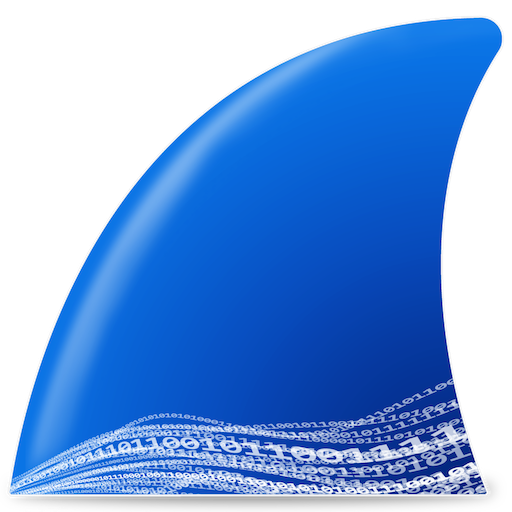
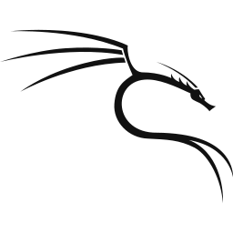
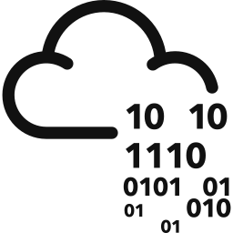
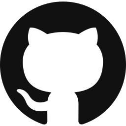

<div align="center">


# Week 2: Network Traffic Analysis, Nmap and Windows Logging

**DG Interns Hub | Cybersecurity Internship**

 &nbsp;
 &nbsp;
 &nbsp;
 &nbsp;
 &nbsp;
 &nbsp;



</div>

---

| | |
|---|---|
| **Intern** | Harini E |
| **Intern ID** | DG/15/OCT/CYBER/040 |
| **Position** | Cyber Security Intern |
| **Week** | 2 |
| **Prepared** | 30 October 2026 |
| **Lab** | VirtualBox: Windows 11, Kali Linux, Ubuntu Server |

## 1. Overview

In Week 2, I learned to read network packets and Windows event logs, so that the endpoint and IDS work in Week 3 makes sense. I completed the theory notes, six TryHackMe rooms, four hands-on tasks, two cheat sheets and three Wireshark sample capture analyses. All tests ran only on my own lab machines, and I used free tools only.

| Part | Result |
|---|---|
| Theory notes | 8 notes, one file for each question |
| TryHackMe rooms | 6 rooms, all at 100% |
| Task 1: Capture traffic | Completed, 1 PCAP file and 6 screenshots |
| Task 2: Nmap scans | Completed, 9 text files, 9 XML files, 1 PCAP file and 10 screenshots |
| Task 3: Windows events | Completed, 6 screenshots |
| Task 4: PowerShell hunting | Completed, 1 CSV file and 1 screenshot |
| Task 5: Cheat sheets | Completed, 2 PDF files |
| Wireshark sample captures | 3 writeups |

## Contents

1. [Overview](#1-overview)
2. [Folder map](#2-folder-map)
3. [Lab environment](#3-lab-environment)
4. [Theory notes](#4-theory-notes)
5. [TryHackMe rooms](#5-tryhackme-rooms)
6. [Hands-on tasks](#6-hands-on-tasks)
7. [Wireshark sample captures](#7-wireshark-sample-captures)
8. [Problems and solutions](#8-problems-and-solutions)
9. [Safety and privacy](#9-safety-and-privacy)
10. [What I learned](#10-what-i-learned)
11. [LinkedIn posts](#linkedin-posts)

## 2. Folder map

```
Week 2/
├── README.md                        This file
├── Week2-Report-Harini.pdf          Weekly report
├── Week2-Presentation-Harini.pptx   Weekly presentation
├── Notes/                           8 theory notes
├── Writeups/                        6 TryHackMe writeups (01 to 06), 3 Wireshark sample capture writeups (07 to 09)
├── Findings/
│   ├── Wireshark/                   Traffic capture and SYN scan screenshots
│   ├── Nmap/                        Nmap scan screenshots
│   ├── Windows Events/              Event Viewer screenshots
│   └── PowerShell Hunting/          PowerShell screenshot and the safe CSV file
├── Captures/
│   ├── PCAP/                        kali-capture.pcap, syn-scan.pcap
│   ├── Nmap -oN/                    9 text output files
│   └── Nmap -oX/                    9 XML output files
└── Cheat Sheets/                    Wireshark filters (20), Windows Event IDs (15)
```

## 3. Lab environment

 The machines are connected by a Host-only network, `192.168.56.0/24`. I did not have a Windows virtual machine, so I used my real laptop as the Windows target.

| Machine | Role | Address |
|---|---|---|
| Windows 11 laptop | Runs VirtualBox, Wireshark and PowerShell. It is also the Windows target. | 192.168.56.1 |
| Kali Linux VM (kali-lab) | Scanning and testing machine | 192.168.56.101 |
| Ubuntu Server VM (ubuntu-lab) | Target machine with Apache 2.4.66 | 192.168.56.102 |

**Tools (all free):** VirtualBox, Kali Linux, Ubuntu Server, Apache, Nmap 7.991, tcpdump, Wireshark 4.6.9, Windows PowerShell, Windows Event Viewer and Google Drive for desktop.

## 4. Theory notes

The eight notes are in the [`Notes`](Notes) folder, one file for each question:

| No. | Topic |
|---|---|
| 1 | TCP three-way handshake and teardown, with a table of TCP flags |
| 2 | What to look for in DNS, HTTP, HTTPS/TLS, ARP, ICMP and SMB traffic |
| 3 | Capture filters and display filters in Wireshark, with 10 examples |
| 4 | Nmap scan types and what each leaves in packets and logs |
| 5 | Windows basics and the three main Event Viewer logs |
| 6 | Fifteen key Windows Security Event IDs |
| 7 | Windows logon types 2, 3, 4, 5, 7, 10 and 11 |
| 8 | What a baseline is and why it matters for a SOC analyst |

## 5. TryHackMe rooms

 All six rooms are completed at 100%. Each room has its own writeup in the [`Writeups`](Writeups) folder, with the completion proof.

| No. | Room | Link |
|---|---|---|
| 01 | Nmap | https://tryhackme.com/room/furthernmap |
| 02 | Nmap Live Host Discovery | https://tryhackme.com/room/nmap01 |
| 03 | Nmap Basic Port Scans | https://tryhackme.com/room/nmap02 |
| 04 | Windows Basics | https://tryhackme.com/room/windowsbasics |
| 05 | Windows Fundamentals 1 | https://tryhackme.com/room/windowsfundamentals1xbx |
| 06 | Windows Fundamentals 2 | https://tryhackme.com/room/windowsfundamentals2x0x |

My public profile: https://tryhackme.com/p/hariniedward

## 6. Hands-on tasks

### Task 1: Capture traffic

  

- I installed Apache on the Ubuntu VM and checked it with `curl -I` from Kali, which returned `HTTP/1.1 200 OK`.
- I recorded the traffic on the Ubuntu VM with tcpdump, because Wireshark on Windows could not see the traffic between the VMs.
- `kali-capture.pcap` has 32 packets. It shows ping, ARP, the TCP handshake, an HTTP GET with a 200 OK reply, the connection closing and three DNS queries.
- The DNS queries got ICMP Port unreachable, because the Ubuntu VM is not a DNS server. I report this as it is.

Evidence: [`Findings/Wireshark`](Findings/Wireshark) and [`Captures/PCAP`](Captures/PCAP)

### Task 2: Nmap scans


All scans ran from Kali, and each one was saved with `-oN` and `-oX`.

| Scan | Target | Result |
|---|---|---|
| `-sn` | 192.168.56.0/24 | 3 hosts up |
| `-sS` | Ubuntu VM | Ports 22 and 80 open, 998 closed |
| `-sV` | Ubuntu VM | OpenSSH 10.2p1 and Apache httpd 2.4.66 |
| `-O` | Ubuntu VM | No exact OS match |
| `-A` | Ubuntu VM | Same services, page title and traceroute, no exact OS match |
| `-sS`, `-sV`, `-O`, `-A` | Windows laptop | All 1000 ports filtered, because the firewall dropped every probe |

`syn-scan.pcap` shows the pattern of a SYN scan. With the filter `tcp.flags.syn==1 && tcp.flags.ack==0`, there are 1000 SYN packets from 192.168.56.101 to 1000 different ports on 192.168.56.102 in about 0.52 seconds. The Ubuntu VM answered with 998 RST packets and 2 SYN-ACK packets (ports 22 and 80).

Evidence: [`Findings/Nmap`](Findings/Nmap), [`Captures/Nmap -oN`](Captures/Nmap%20-oN) and [`Captures/Nmap -oX`](Captures/Nmap%20-oX)

### Task 3: Windows events

I created the events on my Windows laptop with a temporary user, `labtest1`, and found each one with Filter Current Log in Event Viewer.

| Event ID | What I did | Time on 27 October 2026 |
|---|---|---|
| 4720 | Created the user labtest1 | 18:26:25 |
| 4732 | Added labtest1 to Administrators | 18:45:16 |
| 4625 | Failed network logon, Logon Type 3 | 18:54:06 |
| 4624 | Successful network logon, Logon Type 3 | 19:09:38 |
| 7045 | Created and deleted the service LabDummySvc | 19:15:37 |
| 1102 | Cleared the Security log, after saving a backup | 19:22:31 |

At the end, I deleted the user labtest1. My own account was never changed.

Evidence: [`Findings/Windows Events`](Findings/Windows%20Events)

### Task 4: PowerShell hunting

- I used `Get-WinEvent` with `-FilterHashtable` on the backup of the Security log, because I had cleared the live log.
- The backup holds 13 events with ID 4625. I exported them to a CSV file and counted them per account with `Group-Object`.
- Twelve events belong to my own local account (Logon Type 2) and one belongs to labtest1 (Logon Type 3).
- The CSV file in the submission is a safe copy where my account name is replaced by `local-user`.

Evidence: [`Findings/PowerShell Hunting`](Findings/PowerShell%20Hunting)

### Task 5: Cheat sheets

| Cheat sheet | Content |
|---|---|
| Wireshark Filter, Meaning, When to Use It | 20 display filters |
| Windows Event ID, What It Means, When to Use It | The 15 Security Event IDs from the task |

Files: [`Cheat Sheets`](Cheat%20Sheets)

## 7. Wireshark sample captures

 I analysed three sample captures and wrote a separate writeup for each one (07 to 09) in the [`Writeups`](Writeups) folder.

| Writeup | Capture | Protocols | What happened | Suspicious? |
|---|---|---|---|---|
| 07 | `http_with_jpegs.cap.gz` | Ethernet, IPv4, TCP, HTTP | A browser opened a small website and downloaded pictures | No sign of an attack |
| 08 | `telnet-cooked.pcap` | Ethernet, IPv4, TCP, Telnet | A user logged in over Telnet and ran a few commands | No sign of an attack, the login is readable as plain text |
| 09 | `dns.cap` | Ethernet, IPv4, UDP, DNS | Many record types were asked of one server | No sign of an attack, private names went to an outside server |

## 8. Problems and solutions

| Problem | Solution |
|---|---|
| Wireshark on Windows could not see traffic between the VMs | I recorded on the Ubuntu VM with tcpdump and copied the file with `scp` |
| The Host-only addresses disappeared after a reboot | I added them again with `ip addr add` |
| I had no Windows virtual machine | I used my real laptop with a temporary dummy user |
| The Windows firewall blocked all scans | I reported the result as it is, and explained that filtered means no reply |
| The DNS query had no DNS answer | I kept it as evidence and explained why the port is closed |
| Clearing the Security log destroys evidence | I saved a backup with `wevtutil` first and used it for Task 4 |
| Personal details appeared in screenshots and files | I used solid black boxes, masked MAC addresses and made a safe CSV |
| The sample capture was hard to find | I used the GitLab copy of the Wireshark Sample Captures page |
| Wireshark could not save to Google Drive | I saved to drive E first and then copied the file |

## 9. Safety and privacy

- All scans and tests ran only on my own virtual machines and my own laptop.
- The dummy user and the dummy service were deleted after the tests.
- Personal details such as the Windows username, the computer name and MAC addresses are hidden in the screenshots and files.
- Original files with personal details stay on my own drive and are not uploaded.

## 10. What I learned

- A port scan shows many SYN packets to many ports in a very short time.
- A firewall can hide a whole machine from Nmap, and I should report what the scan really shows.
- The Logon Type in events 4624 and 4625 explains how a logon happened.
- Events 4720, 4732, 7045 and 1102 show common attacker steps.
- PowerShell can search and count events faster than Event Viewer.
- Saving evidence before a risky step, and hiding personal details before sharing, are part of careful security work.

## LinkedIn posts

- LinkedIn post 1: https://lnkd.in/p/gxxiaeND
- LinkedIn post 2: https://lnkd.in/p/g_Dg_QHD

---

<div align="center">

*Prepared by Harini for the DG Interns Hub Cyber Security Internship, Week 2.*

</div>
