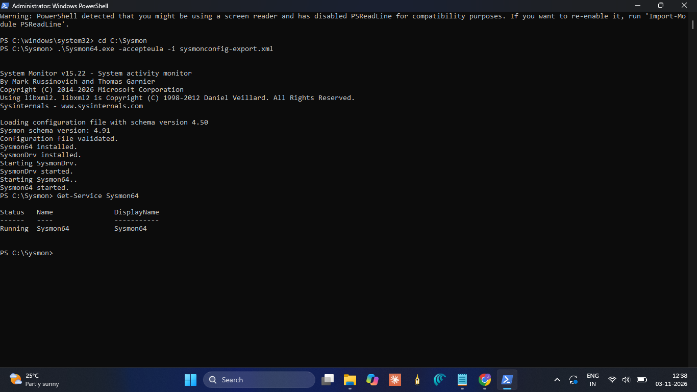
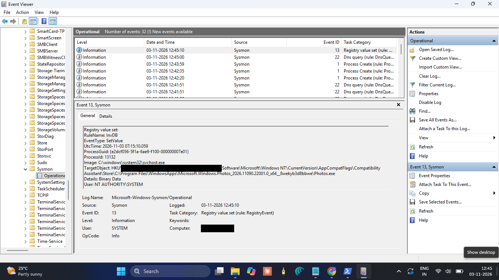

<div align="center">


# Week 3: Linux Logs, Sysmon, auditd and Snort

**DG Interns Hub | Cybersecurity Internship**

 &nbsp;
 &nbsp;
 &nbsp;
 &nbsp;
 &nbsp;
 &nbsp;


</div>

---

| | |
|---|---|
| **Intern** | Harini E |
| **Intern ID** | DG/15/OCT/CYBER/040 |
| **Position** | Cyber Security Intern |
| **Week** | 3 |
| **Topic** | Linux logs, Sysmon, auditd and Snort setup |
| **Lab** | VirtualBox: Windows 11, Kali Linux, Ubuntu 26.04 LTS |

## About this week

Week 3 was about endpoint and network detection. Until now I had mostly read about logs, and this week I generated them myself and then went looking for them. I installed Sysmon on Windows and found my own actions in Event Viewer. I set up auditd on Ubuntu and traced a package command back to the user who ran it. Then I worked with Snort, which became the biggest lesson of the week.

Ubuntu 26.04 has no Snort package, so I had to build Snort 3 from source. Snort 3 also rejects some of the syntax in the task sheet, so I read the errors, fixed the rule, and finally caught an Nmap scan from my Kali machine with my own rule, mapped to MITRE ATT&CK T1046.

This repository holds everything from the week: notes, writeups, screenshots, my Snort rules, a cheat sheet, the report and the presentation.

## Contents

1. [Week at a glance](#week-at-a-glance)
2. [Lab environment](#lab-environment)
3. [Theory notes](#theory-notes)
4. [Sysmon on Windows](#sysmon-on-windows)
5. [auditd on Ubuntu](#auditd-on-ubuntu)
6. [Snort](#snort)
7. [Cheat sheet](#cheat-sheet)
8. [TryHackMe rooms and LetsDefend courses](#tryhackme-rooms-and-letsdefend-courses)
9. [Problems I faced and how I solved them](#problems-i-faced-and-how-i-solved-them)
10. [What I learned](#what-i-learned)
11. [LinkedIn posts](#linkedin-posts)
12. [Repository structure](#repository-structure)
13. [References](#references)

## Week at a glance

| Task | Status |
|---|---|
| Theory notes (10 questions) | Completed, one file per question |
| TryHackMe rooms (4) | Completed |
| LetsDefend courses (6) | Completed |
| Hands-on 1: Install Sysmon | Completed |
| Hands-on 2: Make events and find them | Completed, four events captured |
| Hands-on 3: auditd and ausearch | Completed |
| Hands-on 4: Snort setup and starter rules | Completed, Snort 3 built from source |
| Hands-on 5: Nmap SYN scan rule (MITRE T1046) | Completed, alerts captured |
| Hands-on 6: Cheat sheet | Completed, 19 entries |
| LinkedIn posts (2) | Posted |

## Lab environment

 All the work was done in a small VirtualBox lab on my laptop. The three machines share a host-only network, `192.168.56.0/24`.

| Machine | Role in the lab | Address | Tools |
|---|---|---|---|
| Windows 11 laptop | Host machine, Event Viewer | 192.168.56.1 | Sysmon v15.22, PowerShell |
| Kali Linux VM | Attacker machine for the tests | 192.168.56.101 (eth1) | Nmap 7.991, curl, netcat |
| Ubuntu 26.04 LTS VM (ubuntu-lab) | Defender machine | 192.168.56.102 (enp0s8) | auditd 4.1.2, Snort 3.12.2.0 |

I connect to both VMs over SSH from Windows PowerShell, one tab for Ubuntu and one for Kali. VirtualBox host-only addresses are temporary, so after a reboot I check them and add them back if needed:

```bash
ip a show enp0s8 | grep 192.168.56
sudo ip addr add 192.168.56.102/24 dev enp0s8
```

Every tool used this week is free, as the task rules require.

## Theory notes

I answered the ten theory questions in my own words, with tables and bullet points where the question asked for them, and saved each answer as a separate file in [`Notes/`](Notes).

| No. | Topic |
|---|---|
| 1 | Endpoint Detection and Response (EDR), and how it differs from traditional antivirus |
| 2 | Sysmon, and how it differs from standard Windows Event Logs |
| 3 | auditd on Linux, and the difference between auditd and syslog |
| 4 | How Snort works, and Snort in IDS mode versus IPS mode |
| 5 | The structure of a Snort rule (header and options) |
| 6 | Signature-based versus anomaly-based detection |
| 7 | MITRE ATT&CK T1046 (Network Service Discovery) and mapping Snort rules to it |
| 8 | Comparison of Windows Event Log, Sysmon and Linux auditd |
| 9 | Key Linux log files a SOC analyst should monitor |
| 10 | Log ingestion, and the flow from a log source to a SIEM dashboard |

## Sysmon on Windows

### Installation

I downloaded Sysmon from the Sysinternals site and the SwiftOnSecurity configuration file, saved both in `C:\Sysmon`, and installed it from an elevated PowerShell window with the 64-bit file:

```powershell
.\Sysmon64.exe -accepteula -i sysmonconfig-export.xml
Get-Service Sysmon64
```

My first attempt failed with "You need to launch Sysmon as an Administrator", because the window was not elevated. After I reopened PowerShell as Administrator the install worked, and I confirmed that events were arriving in Event Viewer under `Applications and Services Logs > Microsoft > Windows > Sysmon > Operational`.





### Making events and finding them

I performed four actions and located the matching event for each one. Times are local, on 3 November 2026.

| Action | Event ID | Time | Key fields | Why it matters to a SOC analyst |
|---|---|---|---|---|
| Opened PowerShell | 1 (Process Create) | 12:52:15 | Image, CommandLine, CurrentDirectory, User | Shows what ran, from where, and who ran it |
| Created a test user account | 1 (Process Create) | 12:52:35 | Image `net.exe`, CommandLine `net user ... /add` | Account creation is a common persistence step (T1136) |
| Made a network connection | 3 (Network Connection) | 12:52:52 | SourceIp, DestinationIp 104.20.23.154, port 443 | Ties a process to an outbound connection, useful for spotting command and control |
| Created a text file | 11 (File Create) | 12:56:46 | Image, TargetFilename `sysmon-test.txt` in Downloads | Reveals dropped files and the process that wrote them |


### What I noticed

- My first test file, created in the Temp folder, was not logged at all. The SwiftOnSecurity configuration only records file creation for certain folders and file types, so I created the file in Downloads and it appeared as Event ID 11. A detection setup is only as good as its configuration.
- Running `netstat -ano` was also logged as its own Event ID 1.
- The dummy account and the test files were deleted after I took the screenshots.
- I hid my username and computer name in every screenshot.

A separate document, [`sysmon-events-documentation.pdf`](Findings/Sysmon%20Events/sysmon-events-documentation.pdf), explains each event in more detail.

## auditd on Ubuntu

 

### Setup

```bash
sudo apt-get update
sudo apt-get install -y auditd
sudo systemctl enable auditd --now
sudo systemctl status auditd --no-pager
```

The task asks to search for the key `nano`, but a key only exists if a rule creates it. So I added a rule that records every program run by apt, checked it, and ran the command:

```bash
sudo auditctl -a always,exit -F arch=b64 -S execve -F exe=/usr/bin/apt -k nano
sudo auditctl -l
sudo apt install nano
```

The package was already installed, but apt still ran, so the command was recorded.

### Finding the command in the audit log

```bash
sudo ausearch -k nano -i
sudo ausearch -m EXECVE -ts recent -i
```

The `-i` option turns numbers such as user IDs into readable names. The EXECVE record shows `a0=apt a1=install a2=nano`, which is exactly the command I typed.

### Important fields in the record

| Field | Value in my log | What it tells an analyst |
|---|---|---|
| `type` | EXECVE, SYSCALL, PATH, CWD, PROCTITLE | The kind of record, one command produces several |
| `msg` | `audit(timestamp:serial)` | When it happened, and the number that ties the records together |
| `a0, a1, a2` | apt install nano | The command that was actually run |
| `exe` | /usr/bin/apt | The program that ran |
| `auid` | ubuntu | The user who originally logged in, which stays the same after sudo |
| `uid` / `gid` | root | The user and group the command ran as |
| `tty` / `ses` | pts1 / 4 | The terminal and login session, here my SSH session |
| `key` | nano | The label from my rule, used to search for the event |

Screenshots and the field explanation are in [`Findings/auditd/`](Findings/auditd).

## Snort

 

### The problem: no Snort package

The task says to install Snort with apt. On my Ubuntu 26.04 VM this failed, because the package is not in the repositories for this version. apt answered `Unable to locate package snort`, and searching the package list and enabling the universe repository did not change it.

### The fix: building Snort 3 from source

Snort publishes its source code, so I built Snort 3 myself. The VM has about 1.6 GB of memory, so I built on a single thread to avoid running out of memory.

```bash
# build tools and libraries
sudo apt-get install -y build-essential cmake git autoconf automake libtool pkg-config \
  flex bison libpcap-dev libpcre2-dev libdumbnet-dev zlib1g-dev libhwloc-dev \
  libluajit-5.1-dev libssl-dev libunwind-dev liblzma-dev libsqlite3-dev uuid-dev

# LibDAQ
cd /usr/local/src
sudo git clone --depth=1 https://github.com/snort3/libdaq.git
cd libdaq && sudo ./bootstrap && sudo ./configure --prefix=/usr/local
sudo make -j2 && sudo make install && sudo ldconfig

# Snort 3
cd /usr/local/src
sudo git clone --depth=1 --branch 3.12.2.0 https://github.com/snort3/snort3.git
cd snort3 && sudo ./configure_cmake.sh --prefix=/usr/local
cd build && sudo make -j1
sudo make install && sudo ldconfig
snort -V
```


### Configuration and starter rules

Snort 3 uses a Lua file instead of `snort.conf`. In `/usr/local/etc/snort/snort.lua` I set `HOME_NET` to `192.168.56.0/24` and `EXTERNAL_NET` to `!$HOME_NET`. Then I created `local.rules` with the three starter rules:

| SID | Rule message | What it detects | Kali test that triggered it |
|---|---|---|---|
| 1000001 | ICMP Ping Detected | Any ICMP traffic to HOME_NET | `ping -c 4 192.168.56.102` |
| 1000002 | SSH Connection Attempt | TCP traffic to port 22 | `nc -zv 192.168.56.102 22` |
| 1000003 | HTTP Traffic | TCP traffic to port 80 | `curl -I http://192.168.56.102` |

```bash
# test the configuration (it passed with 0 warnings)
sudo snort -T -c /usr/local/etc/snort/snort.lua -R /usr/local/etc/snort/rules/local.rules -i enp0s8

# run Snort and print alerts to the console
sudo snort -c /usr/local/etc/snort/snort.lua -R /usr/local/etc/snort/rules/local.rules \
  -i enp0s8 -A alert_fast -k none -q
```

My own Windows SSH session to the VM raised constant SSH alerts from `192.168.56.1`, so I later filtered that address out with grep to keep the screen readable.


### The T1046 rule: detecting an Nmap SYN scan

MITRE ATT&CK T1046, Network Service Discovery, is the technique an attacker uses to find out which services are running on a target. An Nmap SYN scan is the usual way to do it, so I wrote a rule for it and tagged it with the technique.

```
alert tcp any any -> $HOME_NET any (msg:"MITRE T1046 - Nmap SYN Port Scan Detected"; flags:S; detection_filter:track by_src, count 20, seconds 1; classtype:attempted-recon; metadata:mitre_technique T1046; reference:url,attack.mitre.org/techniques/T1046/; sid:1000004; rev:1;)
```

| Part of the rule | Meaning |
|---|---|
| `flags:S` | Matches TCP packets with the SYN flag set, the first packet of a connection and the signature of a half-open scan |
| `detection_filter ... count 20, seconds 1` | Alerts only when one source sends 20 SYN packets within one second, so normal connections do not trigger it |
| `classtype:attempted-recon` | Classifies the alert as reconnaissance |
| `metadata:mitre_technique T1046` | Tags the rule with the MITRE technique |
| `reference:url,...` | Links to the official ATT&CK page for T1046 |
| `sid:1000004; rev:1` | The rule number and its revision |

From Kali I ran the scan:

```bash
sudo nmap -sS 192.168.56.102
```

Nmap found ports 22 (ssh) and 80 (http) open, and Snort raised the T1046 alert for many ports within a fraction of a second. The Snort times are in UTC, and the scan ran at 11:08 IST, which is 05:38 UTC.


### Differences from the task sheet

Snort 3 works differently from the version the task sheet was written for. These are the only changes I made, and I list them so that my results can be understood.

| Task sheet | What I did | Why |
|---|---|---|
| Install with apt | Built Snort 3.12.2.0 from source | Ubuntu 26.04 has no Snort package |
| `/etc/snort/snort.conf` | `/usr/local/etc/snort/snort.lua` | Snort 3 uses a Lua configuration file |
| Rules in `/etc/snort/rules/local.rules` | `/usr/local/etc/snort/rules/local.rules`, loaded with `-R` | Snort 3 loads rules with the `-R` option |
| `threshold` option in rule 4 | `detection_filter`, same count and time | Snort 3 gave `unknown rule keyword: threshold` |
| Source `$EXTERNAL_NET` | Source `any` | Kali is inside HOME_NET, so `$EXTERNAL_NET` never matched it |
| Interface `eth0` (example) | `enp0s8` | The real interface name on my VM |

The complete rules file is in [`Snort Rules/local.rules`](Snort%20Rules/local.rules).

## Cheat sheet

I built a cheat sheet with 19 entries that I can reuse when investigating. The full PDF is [`Cheat Sheet/event-id-rule-cheat-sheet.pdf`](Cheat%20Sheet/event-id-rule-cheat-sheet.pdf), and this is the summary:

| Event ID / Rule | Source | What it means | When to use it |
|---|---|---|---|
| 4624 | Windows Security | Successful logon | Comparing normal and unusual logins |
| 4625 | Windows Security | Failed logon | Spotting brute force attempts |
| 4688 | Windows Security | New process created | Tracking program execution |
| 4720 | Windows Security | User account created | Detecting persistence (T1136) |
| 4672 | Windows Security | Special privileges assigned at logon | Spotting administrator level logons |
| 1102 | Windows Security | Audit log cleared | Detecting an attacker hiding their tracks |
| 1 | Sysmon | Process Create | Monitoring process execution and command lines |
| 3 | Sysmon | Network Connection | Detecting command and control or lateral movement |
| 11 | Sysmon | File Create | Detecting dropped files |
| 22 | Sysmon | DNS Query | Detecting DNS based command and control |
| 13 | Sysmon | Registry Value Set | Detecting registry persistence |
| EXECVE | auditd | Command executed with its arguments | Auditing Linux commands |
| USER_LOGIN | auditd | User login | Tracking Linux authentication |
| USER_AUTH | auditd | Authentication attempt | Detecting failed logins |
| CONFIG_CHANGE | auditd | Audit configuration changed | Noticing someone altering the audit rules |
| 1000001 | Snort | ICMP Ping Detected | Detecting network reconnaissance |
| 1000002 | Snort | SSH Connection Attempt | Monitoring SSH access |
| 1000003 | Snort | HTTP Traffic | Monitoring web traffic |
| 1000004 | Snort | Nmap SYN Scan Detected (T1046) | Detecting port scanning |

## TryHackMe rooms and LetsDefend courses

 Each room and course has its own writeup in [`Writeups/`](Writeups).

### TryHackMe

| Room | Level | What it covered |
|---|---|---|
| [Linux Logging for SOC](https://tryhackme.com/room/linuxloggingforsoc) | Easy | Linux log sources such as auth.log, syslog and the audit log, and how to start a Linux investigation |
| [Intro to Logs](https://tryhackme.com/room/introtologs) | Easy | What logs are, log types and formats, collection, centralisation, storage and retention |
| [Intro to Log Analysis](https://tryhackme.com/room/introtologanalysis) | Easy | How to read and investigate logs, command line tools and CyberChef |
| [Snort](https://tryhackme.com/room/snort) | Medium | Snort sniffer, logger and IDS/IPS modes, reading pcap files and writing rules |

### LetsDefend

| Course | What it covered |
|---|---|
| [How to Investigate a SIEM Alert](https://app.letsdefend.io/training/lessons/how-to-investigate-a-siem-alert) | Investigating a SIEM alert from detection to the final result |
| Security Solutions | IDS, IPS, firewall, EDR, antivirus, sandbox, DLP, WAF, proxy and email security |
| SIEM 101 | Log collection, aggregation, parsing, storage and alerting |
| Incident Management | Incident management systems, case naming, playbooks and the analyst workflow |
| Network Log Analysis | Examining network log sources during an investigation |
| Incident Response on Linux | Responding to incidents on Linux, log files and user startup files |

## Problems I faced and how I solved them

| Problem | What I did |
|---|---|
| Sysmon install failed with "You need to launch Sysmon as an Administrator" | Reopened PowerShell as Administrator and ran the install again |
| The test file in the Temp folder was not logged by Sysmon | Learned that the SwiftOnSecurity configuration filters file creation, and used the Downloads folder |
| `ausearch -k nano` finds nothing without a matching rule | Added an audit rule with the key `nano` before running the command |
| apt could not find Snort on Ubuntu 26.04 | Built Snort 3 from source, on a single thread because the VM has little memory |
| A `sed` command with `!` failed with "event not found" | Used single quotes so that bash did not treat `!` as history expansion |
| Rule 4 failed with `unknown rule keyword: threshold` | Used `detection_filter`, which does the same job in Snort 3 |
| The scan raised no alerts at first | Found that Kali is inside HOME_NET, so I changed the rule source from `$EXTERNAL_NET` to `any` |
| My own SSH session filled the screen with SSH alerts | Filtered the alerts from 192.168.56.1 with grep |

## What I learned

Endpoint logs give much more context than standard operating system logs. Sysmon showed me the full command line, the process behind a network connection and where files were created, and auditd showed me the command that ran and the original user behind it, even after sudo. I also learned that a detection setup is only as good as its configuration, because the Temp folder file was never logged until I understood how the configuration filters events.

Snort taught me how a rule is built and why testing matters. Working through the Snort 3 differences made me read error messages carefully and understand each option, instead of copying the rule as it was. The LetsDefend and TryHackMe work gave me the bigger picture of how these logs reach a SIEM and how an analyst investigates an alert from start to finish.

**Skills I practised this week**

- Installing and configuring Sysmon, and finding events in Event Viewer
- Writing audit rules and searching the audit log with `ausearch`
- Building software from source, and configuring and testing Snort 3
- Writing a Snort detection rule and mapping it to a MITRE ATT&CK technique
- Documenting my work clearly, with screenshots as evidence

## LinkedIn posts

I shared my learning in two posts, tagging DG Interns Hub.

- Why endpoint logging is more valuable than standard OS logs: https://lnkd.in/p/gfEBSgcX
- My Week 3 experience: https://lnkd.in/p/gpRXcerg

## Repository structure

```
Week 3/
├── README.md
├── Week_3_Internship_Report.pdf
├── Week_3_Presentation.pptx
├── assets/                 logos used in this README
├── Notes/                  10 theory answers, one file each
├── Writeups/               TryHackMe and LetsDefend writeups, one file each
├── Findings/
│   ├── Sysmon Events/      event screenshots and documentation
│   ├── auditd/             audit log screenshots and field explanation
│   └── Snort/              setup, test and alert screenshots
├── Cheat Sheet/            event-id-rule-cheat-sheet.pdf
└── Snort Rules/            local.rules
```

## References

- [Sysmon, Microsoft Sysinternals](https://learn.microsoft.com/en-us/sysinternals/downloads/sysmon)
- [SwiftOnSecurity Sysmon configuration](https://github.com/SwiftOnSecurity/sysmon-config)
- [Linux audit documentation](https://github.com/linux-audit/audit-documentation)
- [Snort 3 source](https://github.com/snort3/snort3) and [LibDAQ](https://github.com/snort3/libdaq)
- [MITRE ATT&CK T1046, Network Service Discovery](https://attack.mitre.org/techniques/T1046/)

---

<div align="center">

*Thank you to DG Interns Hub for the structured tasks, which helped me move from reading about these tools to using them.*

</div>
