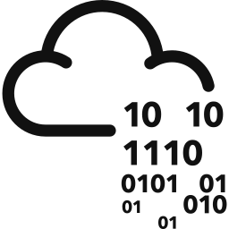

<div align="center">


# Week 5: Phishing, Malware Triage, Threat Intelligence and Incident Response

**DG Interns Hub | Cybersecurity Internship**

 &nbsp;


</div>

---

| | |
|---|---|
| **Intern** | Harini E |
| **Intern ID** | DG/15/OCT/CYBER/040 |
| **Position** | Cyber Security Intern |
| **Week** | 5 |
| **Prepared** | 22 November 2026 |
| **Lab** | Windows 11 laptop with Windows Defender, Sysmon and Splunk Enterprise, plus public Any.Run sandbox reports |

## 1. Overview

In Week 5, I worked like a Tier 1 and Tier 2 analyst. I read three public phishing emails without opening their links, triaged malware safely with the EICAR test file and two public Any.Run reports, mapped what I saw to MITRE ATT&CK, tested three techniques on my own laptop and wrote an incident report. I completed the theory notes, four TryHackMe rooms, all six hands-on tasks (including the two cheat sheets) and two LinkedIn posts. The MITRE room needs a premium plan, so I skipped it as the admin said to do. I did not do the optional rooms or the extra challenges. I used only free tools, and I never downloaded or ran live malware.

| Part | Result |
|---|---|
| Theory notes | 8 notes, one file for each question |
| TryHackMe rooms | 4 completed. The MITRE room needs a premium plan, so I skipped it |
| Task 1: Phishing analysis | Completed, 3 public emails, all malicious |
| Task 2: Safe malware triage | Completed, the EICAR test on my laptop and 2 public Any.Run reports |
| Task 3: ATT&CK map | Completed, a Navigator layer with 23 techniques, its JSON file and a screenshot |
| Task 4: Atomic tests | Completed by hand, T1059.001, T1136.001 and T1053.005. No alert fired for any of them |
| Task 5: Incident report | Completed, case IR-W5-001, severity High, 2 pages |
| Task 6: Cheat sheets | Completed, an IOC table with 12 entries and a one page phishing checklist |
| Optional work | Not done this week: the optional rooms and the extra challenges |
| LinkedIn posts | 2 posts |

## Contents

1. [Overview](#1-overview)
2. [Folder map](#2-folder-map)
3. [Lab environment](#3-lab-environment)
4. [Theory notes](#4-theory-notes)
5. [TryHackMe rooms](#5-tryhackme-rooms)
6. [Hands-on tasks](#6-hands-on-tasks)
7. [Problems and solutions](#7-problems-and-solutions)
8. [Safety and privacy](#8-safety-and-privacy)
9. [What I learned](#9-what-i-learned)
10. [LinkedIn posts](#linkedin-posts)

## 2. Folder map

```
Week 5/
├── README.md                          This file
├── Week5-Report-Harini.pdf            Weekly report
├── Week5-Presentation-Harini.pptx     Weekly presentation
├── Notes/                             8 theory notes
├── Writeups/                          4 TryHackMe writeups
├── Findings/                          Phishing_Analysis.pdf, Malware_Triage.pdf,
│                                      Atomic_Red_Team_Tests.pdf,
│                                      Task3_ATTACK_Technique_Document.pdf,
│                                      the Navigator layer (JSON file and screenshot),
│                                      and the folders Phishing, Malware Triage
│                                      and Atomic Red Team with my screenshots
├── Incident Report/                   Incident_Report_Week5.pdf
└── Cheat Sheet/                       IOC table and phishing red-flag checklist (PDF files)
```

## 3. Lab environment

I did the Week 5 work on my Windows 11 laptop, which runs Windows Defender, Sysmon and the Splunk Enterprise setup from Week 4. I do not have a Windows virtual machine, and the laptop has little free disk space, so I kept the tests small. [Section 6, Task 4](#task-4-atomic-tests) explains how.

| Tool | What I used it for |
|---|---|
| VirusTotal, urlscan.io, AlienVault OTX | Checking the domains and links from the phishing emails without clicking them |
| Any.Run (public reports) | Reading the process tree, network IOCs and ATT&CK techniques of two malware runs |
| Windows Defender | Detecting and quarantining the EICAR test file |
| Sysmon (SwiftOnSecurity configuration) | Process, file and network events from my laptop |
| Splunk Enterprise | Searching the Sysmon and Windows Security events in the `lab` index |
| ATT&CK Navigator | Building one layer for the techniques from Weeks 2 to 5 |

All tools used are free, as the task rules require.

## 4. Theory notes

The eight notes are in the [`Notes`](Notes) folder, one file for each question:

| No. | Topic |
|---|---|
| 1 | The incident response lifecycle (NIST SP 800-61), with a table of actions in each phase |
| 2 | Phishing types and a red-flag checklist |
| 3 | SPF, DKIM and DMARC, with a pass and a fail example |
| 4 | How to read an email header |
| 5 | IOC compared with IOA, and the Pyramid of Pain |
| 6 | MITRE ATT&CK compared with the Cyber Kill Chain, with five attacks from Weeks 2 to 4 mapped to techniques |
| 7 | Static and dynamic malware analysis, what a sandbox does, and the safety rules for samples |
| 8 | What goes into an incident report, severity levels, escalation and a report template |

## 5. TryHackMe rooms

 I completed four of the five core rooms, and each one has its own writeup in the [`Writeups`](Writeups) folder. The fifth room, MITRE, needs a premium plan. The admin said to skip any room that asks for premium, so I skipped it.

| No. | Room | What it is about | Link |
|---|---|---|---|
| 01 | Cyber Kill Chain | The stages of an attack, from the first look at a target to the final goal | https://tryhackme.com/room/cyberkillchainzmt |
| 02 | Pyramid of Pain | Indicators from hashes up to attacker behaviour, and how hard each is for an attacker to change | https://tryhackme.com/room/pyramidofpainax |
| 03 | Phishing Analysis Fundamentals | How to take a phishing email apart and read its parts | https://tryhackme.com/room/phishingemails1tryoe |
| 04 | Intro to Cyber Threat Intel | The basics of collecting and using threat intelligence | https://tryhackme.com/room/cyberthreatintel |

My public profile: https://tryhackme.com/p/hariniedward

## 6. Hands-on tasks

### Task 1: Phishing analysis


I analysed three emails from the public `phishing_pot` collection on GitHub. For each one I read the headers, checked the link in urlscan.io without clicking it, looked the domain up in VirusTotal and AlienVault OTX, and gave a verdict. None of the three emails had an attachment, so there were no file hashes to check. I also looked at sample-10020, a fake McAfee and Norton renewal calendar invite, but it had no link to check, so I did not use it.

| Sample | Lure | SPF / DKIM / DMARC | Link check | Verdict |
|---|---|---|---|---|
| sample-10007 | Fake Ledger firmware notice | Pass / Pass / Pass | VirusTotal 9 of 92. urlscan.io ended on wikipedia.org | Malicious |
| sample-10008 | Casino bonus scam | Fail / Fail / None | VirusTotal 8 of 92. urlscan.io DNS error | Malicious |
| sample-10017 | Fake Ripple XRP giveaway | Pass / Pass / Pass | VirusTotal 0 of 92 with tags nxdomain and dga. urlscan.io DNS error | Malicious |

**Red flags found**

| Sample | Red flags |
|---|---|
| sample-10007 | An urgent deadline, leftover template text (Lorem ipsum and %Link%), a spam score of SCL 5, and it landed in Junk. Authentication passed because it was sent through a real marketing platform |
| sample-10008 | A free onmicrosoft.com address that uses a casino name, a +$300 welcome bonus, a failed Microsoft composite check, a spam score of SCL 8, hidden random text meant to fool spam filters and a tracking pixel |
| sample-10017 | The sender name says Ripple but the address belongs to a different domain. Every button, including Unsubscribe, goes to a lookalike domain. Authentication passed only for the scammer's own domain |

**Main IOCs (defanged)**

| Sample | Indicators |
|---|---|
| sample-10007 | `visit-ledger[.]at`, `hxxps[://]visit-ledger[.]at/rulese`, `91[.]240[.]194[.]253` (sender IP) |
| sample-10008 | `woondsplay[.]com` |
| sample-10017 | `mail97-ripple[.]com`, `bounce[.]yandy[.]com`, `159[.]135[.]225[.]94` (Mailgun, context only) |

A pass on SPF, DKIM and DMARC does not make an email safe, and a clean score on a tool can be wrong when a domain is already dead. The full IOC tables are in `Phishing_Analysis.pdf`.

Evidence: [`Findings`](Findings)

### Task 2: Safe malware triage

**Part A: the EICAR test on my laptop.** The EICAR file is a harmless test file that every antivirus is built to catch. I made it with PowerShell in a test folder at 14:50:11 on 21 November 2026.

| Source | Event ID | Time | What it showed |
|---|---|---|---|
| Defender | 1116 | 14:50:11 | Detected `Virus:DOS/EICAR_Test_File`, severity Severe, Real-Time Protection |
| Defender | 1117 | 14:50:32 | Action taken: Quarantine on the same file |
| Sysmon | None found | | I searched the Sysmon log for the word eicar, in the last 500 events and then in the exact two minutes of the test. Nothing came back |

I repeated the test with a file in my Downloads folder at 15:10:05. This time Sysmon logged Event ID 11 (file created), created by `powershell.exe`, and Defender again raised events 1116 and 1117. I did not find out why the first folder had no Sysmon event, so I only report what I saw.

**Part B: two public Any.Run reports.** Both are public sandbox runs, not my own lab.

| | Report 1 | Report 2 |
|---|---|---|
| Link | https://app.any.run/tasks/947fb10b-46b1-4c58-94c5-c9fc4653441b/ | https://app.any.run/tasks/f0592672-ef97-49b1-b962-9ee6b28be1e3/ |
| Run | Windows 10, 130 seconds, 21 Nov 2026, Malicious activity | Windows 10, 84 seconds, 21 Nov 2026, Malicious activity |
| What it is | A zip with an email, then a JavaScript loader | A zip with Excel files, tagged TrickBot |
| Process tree | WinRAR.exe opens the zip and OUTLOOK.EXE opens Message.eml inside it. A second zip holds a JavaScript file. WinRAR starts wscript.exe, which starts ping.exe against 127.0.0.1. Later WmiPrvSE.exe starts PixelLite83.exe (tagged xworm) | WinRAR.exe opens the zip, and two EXCEL.EXE processes open the files ending in 5c33.xlsx and 5c33.xls |
| Network IOCs | A duckdns.org domain with the IP `109[.]120[.]139[.]126`, and the Suricata alert ET INFO DYNAMIC_DNS (SID 2042936, T1568) | None. All 28 DNS requests were normal Microsoft, Office, Windows and DigiCert domains, plus google.com. The file hash is the main IOC |
| Techniques shown | T1059.007, T1140, T1082, T1083, T1565 (wscript.exe). T1548.002, T1547.001, T1112, T1012, T1497.003, T1614 (PixelLite83.exe) | T1204.002 only |
| Persistence | Yes, a Startup folder file and a Registry run key | Not observed |
| Credential access | Not observed | Not observed |
| Lateral movement | Not observed | Not observed |

In Report 2, the run lasted only 84 seconds, so the malware may not have reached its later stage. I did not add any technique that Any.Run did not show.

Evidence: [`Findings`](Findings)

### Task 3: ATT&CK map

I built one Navigator layer (Enterprise ATT&CK v20) for the techniques I met in Weeks 2 to 5. It has 23 techniques, and each one has a comment with the reason, the week and the log source or detection that showed it. The layer is coloured by week.

| Week | Colour | Techniques |
|---|---|---|
| Week 2 | Blue (5) | T1110, T1136.001, T1078, T1543.003, T1070.001 |
| Week 3 | Green (2) | T1059.001, T1046 |
| Week 4 | Orange (1) | T1110.001 |
| Week 5 | Purple (15) | T1566.002 (my phishing analysis), T1053.005 (my own test), and 13 from the public Any.Run reports: T1204.002, T1059.007, T1140, T1565, T1082, T1083, T1012, T1614, T1497.003, T1547.001, T1548.002, T1112, T1568 |

The 13 techniques from Any.Run were not run in my own lab, and the comments in the layer say so. Where I wrote a possible detection for them, I did not run it in Splunk. The layer JSON file, the screenshot and a document that explains every technique are in the [`Findings`](Findings) folder.

### Task 4: Atomic tests

I ran three small tests on my Windows laptop and looked for the evidence in Sysmon, the Windows Security log and Splunk. I have no Windows VM, so I could not take a VM snapshot, and I made a Windows restore point called Before Atomic Tests instead. To keep the laptop safe and the disk use small, I did not install the Atomic Red Team tool. For each technique I ran one small dummy command by hand, in the same idea as an atomic test, and I deleted the dummy user and the dummy task afterwards.

| Technique | What I ran | Evidence | Alert? |
|---|---|---|---|
| T1059.001 PowerShell | A harmless encoded command that prints one line, at 18:22:22 on 21 Nov | Sysmon Event ID 1 with `-EncodedCommand` in the command line. Splunk search: 1 event | No |
| T1136.001 Create Local Account | `net user` with a dummy name and `/add`, at 08:23:34 on 22 Nov | Sysmon Event ID 1 (net1.exe) and Security Event ID 4720. Splunk search: 2 events | No |
| T1053.005 Scheduled Task | `schtasks /Create` for a dummy task set for 23:00, at 08:33:41 on 22 Nov | Sysmon Event ID 1 (schtasks.exe). Splunk search: 1 event. No Security Event ID 4698 | No |

At the end I searched Splunk for fired alerts over the last 24 hours with `index=_audit action=alert_fired`, and it returned 0 events. My two alerts from Week 4 only cover failed Windows logons and failed SSH logins, so none of the tests could raise one.

**Detection gaps I found**

| Gap | What I would do |
|---|---|
| No rule for the `-EncodedCommand` switch in PowerShell | Alert on EncodedCommand in Sysmon Event ID 1 |
| The Event ID 4720 search is only a search and a dashboard panel | Turn it into a scheduled alert |
| No rule for `schtasks /Create`, and Windows auditing for scheduled tasks was off (Other Object Access Events was No Auditing) | Alert on `schtasks /Create` in Sysmon Event ID 1, and turn on that audit setting so Event ID 4698 is logged |

Evidence: [`Findings`](Findings)

### Task 5: Incident report

I wrote a two page incident report on one case: the Any.Run Report 1 phishing zip that delivers a JavaScript loader. I chose it because it gave a full story with a timeline, persistence and a dynamic DNS domain. The report says clearly that the evidence comes from a public sandbox run and not from my own lab.

| | |
|---|---|
| **Case ID** | IR-W5-001 |
| **Severity** | High, because the loader used persistence, a UAC bypass and a dynamic DNS domain on a machine that could be controlled remotely. It is not Critical, because I saw no data theft, no spread to other machines and no encryption |
| **Contents** | Summary, timeline, defanged IOC table, ATT&CK and Kill Chain mapping, severity with the reason, containment actions and recommendations |
| **Containment (recommended)** | Isolate the computer, block the domain and IP, remove the Startup and Run key entries, delete the email and reset passwords |
| **Detection ideas** | `wscript.exe` started by WinRAR, `wscript.exe` running ping against 127.0.0.1, DNS queries to duckdns.org (Sysmon Event ID 22), and new Startup folder files and Run keys (Sysmon Event IDs 11 and 13) |

File: `Incident_Report_Week5.pdf` in [`Incident Report`](Incident%20Report)

### Task 6: Cheat sheets

| Cheat sheet | Content |
|---|---|
| IOC Type - Where to Find It - Tool to Check It | 12 entries: IP address, domain, URL, MD5 and SHA256 hashes, sender address, email authentication results, file name, command line, Base64 text, Registry key, and scheduled task or service name |
| Phishing red-flag checklist | One page with six groups of boxes to tick: the sender, authentication in the header, links, the message, attachments and what to do next |

Both are saved as PDF files in [`Cheat Sheet`](Cheat%20Sheet).

## 7. Problems and solutions

| Problem | Solution |
|---|---|
| I have no Windows VM, only Ubuntu and Kali VMs, and little free disk space | I ran the EICAR test and the three tests on my laptop, made a restore point first, ran dummy commands by hand and deleted them afterwards |
| urlscan.io could not scan two of the link domains, because they were already taken down | I used VirusTotal and AlienVault OTX, and noted that 0 of 92 does not mean safe |
| No Sysmon event for the first EICAR file | I repeated the test in my Downloads folder, where Sysmon logged Event ID 11, and reported only what I saw |
| Any.Run asked me to sign up to open the ATT&CK matrix | I read the technique IDs from the details page of each process instead |
| Navigator showed an upgrade message from v16 to v20 | My first layer file was written for v16. I checked the lists of revoked and removed techniques, found none of mine, and rebuilt the layer for v20 |
| Security Event ID 4698 was missing | The audit setting Other Object Access Events was No Auditing. I used Sysmon Event ID 1 as the evidence and wrote it as a detection gap |
| The TryHackMe MITRE room needed a premium plan | I skipped it, as the admin said to do |

## 8. Safety and privacy

- I never opened a phishing link or an attachment. I did not download or run any live malware.
- The only file I ran was the harmless EICAR test file. The malware reports I read are public Any.Run sandbox runs.
- The phishing emails come from the public `phishing_pot` collection. The long tracking code at the end of one link is left out of my report.
- The Windows user name and the computer name are hidden in my screenshots.
- The three atomic tests used dummy commands on my own laptop, and I deleted the dummy user and the dummy task afterwards.

## 9. What I learned

- A pass on SPF, DKIM and DMARC only proves that the sender owns the domain. It does not make an email safe.
- A clean score on VirusTotal can be wrong when a domain is already dead.
- Read the process tree of a sandbox report from the top, and write only the techniques that the tool showed. The TrickBot run showed very little, so I did not write more than the evidence says.
- Seeing an event in Sysmon is not the same as having a detection. No alert told me about my three tests, and I only found the events by searching for them myself. My next step is to turn the searches for encoded PowerShell, new user accounts and scheduled tasks into scheduled alerts.

**Limits of this week's work**

- I did not use a Windows VM or the Atomic Red Team tool. I ran the tests by hand on my laptop.
- The two Any.Run reports are public sandbox runs, not my own lab, and I only listed the techniques that Any.Run showed.
- I did not find out why Sysmon had no event for the first EICAR file.
- I did not do the optional rooms or the extra challenges this week.

## LinkedIn posts

- Concept post: https://lnkd.in/p/gsyv_cK3
- Weekly post: https://lnkd.in/p/gPAhnmE5

---

<div align="center">

*Prepared by Harini for the DG Interns Hub Cyber Security Internship, Week 5.*

</div>
